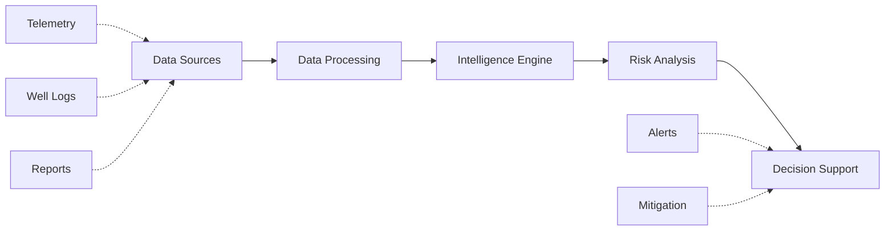

# Drill-IQ

[]()
[]()

## 1. Project Overview

**Drill-IQ** is an AI-powered offset well intelligence and drilling decision support platform. It tackles one of the most significant challenges in modern drilling: turning vast amounts of historical data and documentation into actionable, real-time foresight. 

Rather than relying purely on geographic proximity to find relevant offset wells, Drill-IQ analyzes formation similarity, depth alignment, and historical event parallels to provide context-aware, explainable intelligence that helps drilling engineers mitigate risks before they occur.

## 2. Key Features

- 🗺️ **Well Map:** Interactive geospatial visualization of active and historical offset wells with risk indicators.
- 📊 **Offset Intelligence:** Ranks offset wells based on a comprehensive "Offset Relevance Score" (combining formation, depth, trajectory, and event similarities).
- 🧬 **Well Fingerprint:** Deep-dive analysis of individual wells, including formation profiles, drilling parameters, and historical events.
- 🕸️ **Knowledge Graph:** Searchable repository of structured historical knowledge extracted from WCRs, DDRs, and mud logs.
- ⚠️ **Risk Intelligence:** Predictive modeling that highlights upcoming risk zones (e.g., Mud Loss, Stuck Pipe) using historical precedents.
- 🤖 **AI Assistant:** Conversational agent for querying drilling history, comparing wells, and explaining risk factors in plain English.

## 3. System Workflow



1. **Data:** Ingestion of historical well data, WCRs, and real-time drilling parameters.
2. **Processing:** Normalization, NLP extraction, and similarity indexing.
3. **Intelligence:** Calculation of Offset Relevance Scores and event correlations.
4. **Risk Analysis:** Matching current drilling trajectory with historical failure conditions.
5. **Decision Support:** Providing explainable AI insights, early warnings, and mitigation strategies.

## 4. Tech Stack

- **Frontend:** React 19, TypeScript, Vite, Tailwind CSS, TanStack Router, Recharts, Leaflet
- **Backend (Envisioned):** Node.js / Python (FastAPI)
- **AI / ML (Envisioned):** LLMs for unstructured report parsing, embeddings for similarity matching
- **Database (Envisioned):** PostgreSQL (Relational), Pinecone (Vector), Neo4j (Knowledge Graph)
- **Deployment:** Vercel / AWS

*(Note: The current iteration is a frontend-centric prototype utilizing synthetic fixtures to simulate complex backend/ML interactions.)*

## 5. Project Structure

```text
Drill-IQ/
├── public/                 # Static assets
├── src/
│   ├── components/         # Reusable UI components
│   ├── hooks/              # Custom React hooks
│   ├── lib/                # Utilities and configurations
│   ├── routes/             # TanStack routing configuration
│   └── main.tsx            # Application entry point
├── vite.config.ts          # Vite configuration
├── package.json            # Dependencies and scripts
└── README.md               # Project documentation
```

## 6. Setup & Installation

To run the project locally:

1. **Clone the repository:**
   ```bash
   git clone https://github.com/invo-coder19/Drill-IQ.git
   cd Drill-IQ
   ```

2. **Install dependencies:**
   ```bash
   npm install
   # or
   bun install
   ```

3. **Start the development server:**
   ```bash
   npm run dev
   # or
   bun dev
   ```

4. **Access the application:**
   Open your browser and navigate to `http://localhost:5173`.

## 7. Usage

1. **Select an Active Well:** Start by selecting the well currently being drilled.
2. **Review Offset Intelligence:** Drill-IQ will automatically surface and rank the most relevant historical wells.
3. **Monitor Real-Time Parameters:** Watch simulated telemetry as depth progresses.
4. **Analyze Risks:** Pay attention to alerts and high-risk zones populated by the Risk Engine.
5. **Query the AI:** Ask the AI Assistant for specific mitigation strategies or to compare specific offset wells.

## 8. Future Scope

- **Real-time eRTMAC Integration:** Connect to live WITSML/ETP streams for true real-time analysis.
- **Improved Predictions:** Implement advanced machine learning models trained on larger, real-world datasets.
- **Continuous Learning:** Allow the system to automatically update its knowledge graph as new daily drilling reports (DDRs) are generated.
